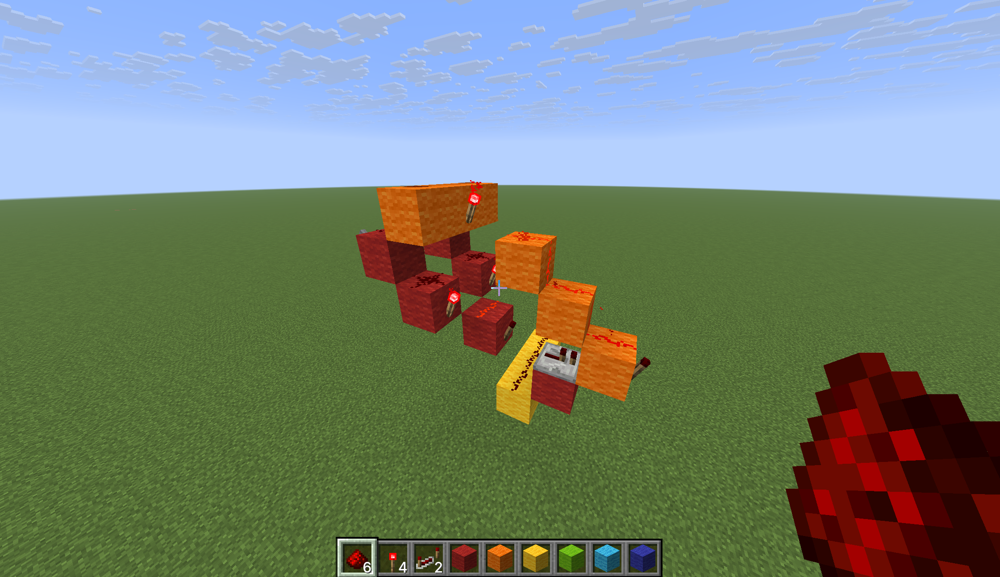
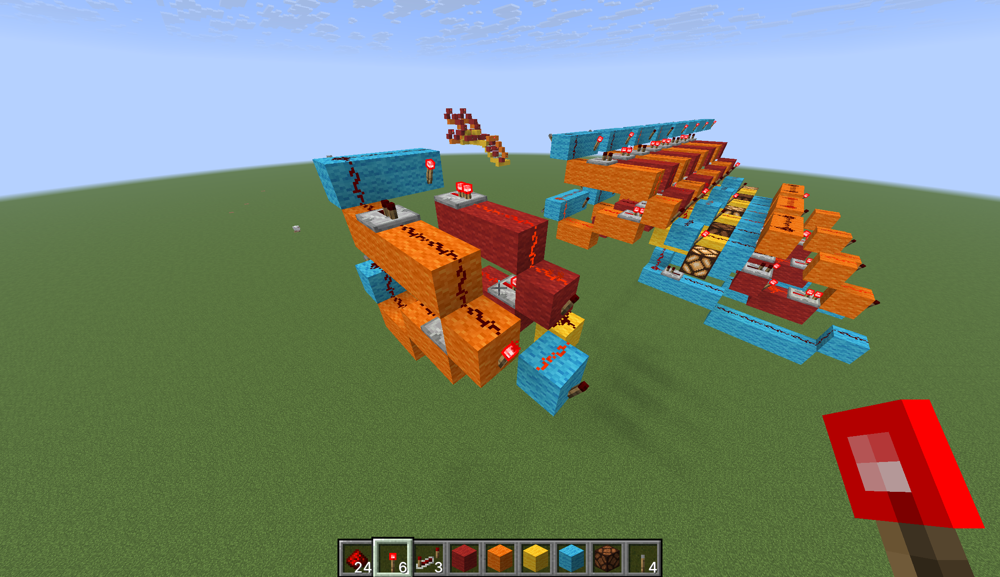
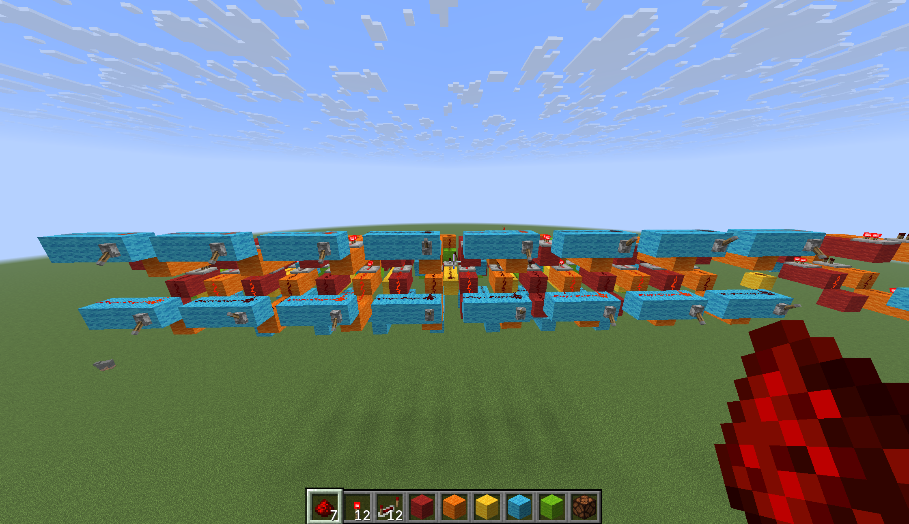
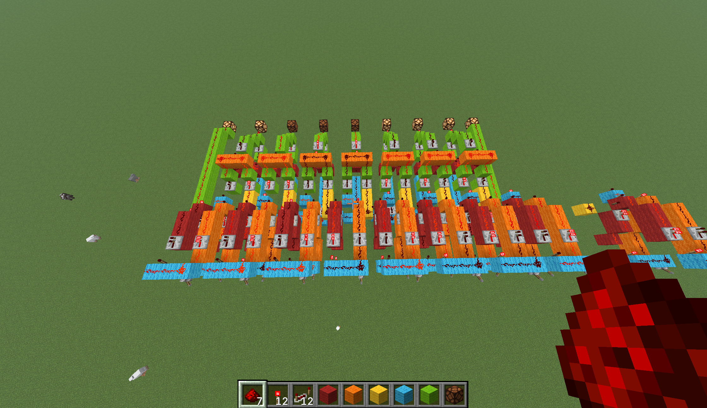

+++
date = '2026-10-16T20:47:33+08:00'
draft = false
title = 'Minecraft数电研究(1)'
+++

# 一 前言
好久没写博客了，上了高二实在是太忙了，没啥时间搞爱好。code啥的更是被搁置，没时间写大工程。  
不过游戏倒是一直在玩。。。也有点浪费时间的意味。  
闲话少说，今天考完试放假有时间瞎搞，就去mc玩了玩数电，自己捅咕出来了一个十分丑陋的加法器。下面简单说说怎么搞出来的。  
# 二 正文
首先我们要知道异或可以写成与或非的基本表达式。这里我经过114514秒深度思考，推出了这个玩意：
$$ A \oplus B = \overline{(AB)}(A + B) $$
这样把与或非三个门堆来堆去，我们得到了一个异或门，如图所示：  

图中红色部分为与门，橙色部分为或门，黄色部分为进位标志。  
接着我们需要把它改成竖版的异或门，以适配加法器的需求。改装后的异或门像这样：

这样我们就获得了一个半加器。为什么是半加器而不是全加器呢，因为我们没有把进位纳入运算。要把进位纳入运算，我们可以把进位标志和下一位的运算结果进行一次异或（此处异或门采用最初建造的横向异或门），再把这样算出来的结果去和下一位的进位标志进行或运算，经过一系列改装、复制以后，我们获得了最终版加法器：

蓝色和绿色是一些拉线用的羊毛，绿色部分是进位运算的异或门。
完结撒花。

# 三 后记
其实我不会布线，完全是乱堆。不过对我来说也是意义重大的，第一次纯靠自己搓出来这玩意了。  
下次更新不知道还要等到啥时候。就这样吧。